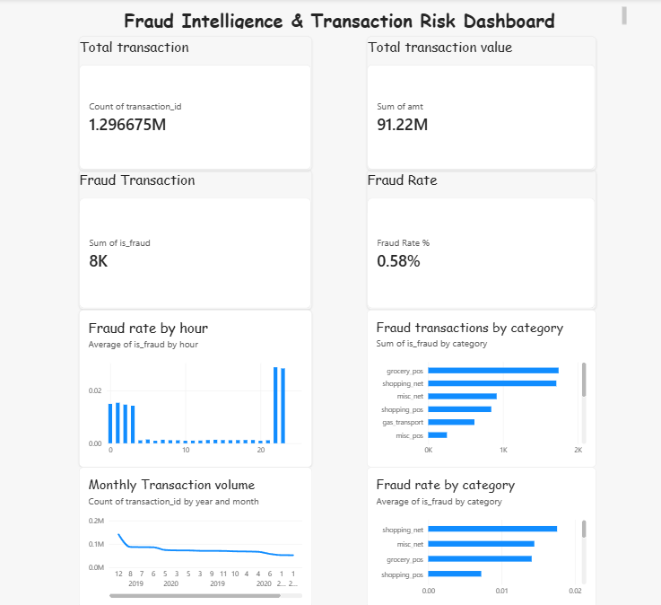

# Fraud Intelligence & Transaction Risk Decision Engine

A data analytics and machine learning project exploring simulated credit card transactions, fraud patterns, and transaction risk.

##  Project Objective

To analyze transaction behaviour, identify patterns associated with fraudulent transactions, and evaluate a baseline machine learning model for fraud detection.

##  Tech Stack

- **Python:** Pandas, NumPy, Scikit-learn, Matplotlib, Seaborn
- **SQL & SQLite:** Data analysis and querying
- **Power BI:** Dashboard and business insights
- **Joblib:** Model persistence

##  What I Did

- Cleaned and explored transaction data using Python.
- Organized data into transaction, customer, merchant, and category tables.
- Wrote SQL queries to analyze fraud by category, time, merchant, and customer.
- Engineered behavioural features using transaction history.
- Built a logistic regression baseline model.
- Evaluated model performance using precision, recall, F1-score, and a confusion matrix.
- Developed a Power BI dashboard to visualize transaction activity and fraud patterns.

##  Model Performance

At a classification threshold of 0.70, the model achieved the following results on the provided test dataset.

| Metric | Result |
|---|---:|
| Precision | 5.28% |
| Recall | 68.58% |
| F1-score | Approximately 9.80% |

**What this means:** The model detected a substantial proportion of fraudulent transactions, but also flagged many legitimate transactions. Reducing false positives is a key area for improvement.

##  Power BI Dashboard


The dashboard summarizes transaction volume, transaction value, fraud count, fraud rate, and patterns across time and categories.

**

##  Key Learnings

- Data cleaning and exploratory data analysis
- SQL-based investigation and aggregation
- Behavioural feature engineering
- Classification with imbalanced data
- Model evaluation and threshold selection
- Business intelligence and dashboard design

##  Limitations & Future Improvements

- The dataset is simulated and does not establish real-world fraud patterns.
- The baseline model produces too many false positives for practical deployment.
- Future work includes improving features, testing alternative models, and evaluating business costs associated with missed fraud and false alarms.

##  Project Structure

```text
Fraud_Intelligence_project/
├── Python/
├── SQL/
├── Data/
│   ├── Raw/
│   └── Processed/
├── database/
├── README.md
└── Fraud_Intelligence_Dashboard.pbix
```

## Project Status

Portfolio project — baseline analytics, model evaluation, and dashboard development completed. Further model validation and improvement remain possible.
